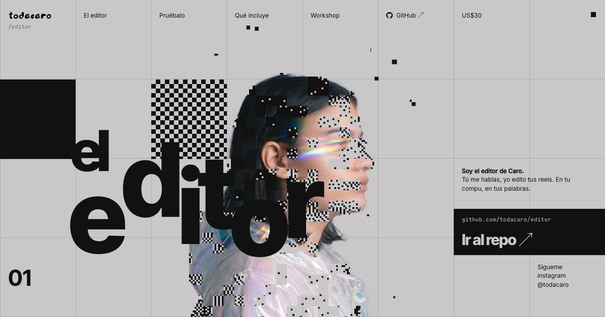
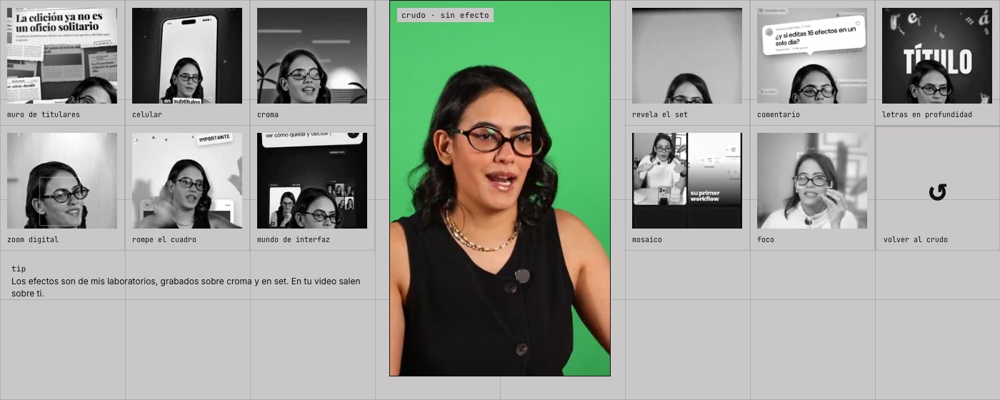

# el editor

El editor de reels de [Carolina Jansen](https://instagram.com/todacaro), dentro de Claude Code. Le das tu grabación, le dices lo que quieres en tus palabras y te entrega el reel vertical listo para publicar.

**Mira los efectos en acción y consíguelo en [todacaro.tech/editor](https://todacaro.tech/editor/).**

## Qué hace

- **Limpia la grabación:** junta tomas, arregla luz y audio, transcribe palabra por palabra y quita silencios, muletillas y repeticiones.
- **Propone efectos con razón:** cada efecto tiene que aportar algo a lo que dices. Si no aporta, el tramo queda limpio.
- **Trae 75 efectos:** muro de titulares, celular, croma, zoom digital, rompe el cuadro, letras en profundidad, mosaico, foco y muchos más.
- **Revisa antes de mostrarte nada:** formato, volumen, palabras cortadas, textos que tapa Instagram y choques con tu cara.
- **Aprende tu estilo:** lo que apruebas queda en tu perfil para el próximo video.

## Qué necesitas

- Una Mac con chip Apple (M1 o más nuevo) y unos 6 GB libres.
- [Claude Code](https://claude.com/claude-code).
- Una cuenta de GitHub, para recibir el acceso al código.

## Cómo funciona la compra

1. Compras en [todacaro.tech/editor](https://todacaro.tech/editor/) con tu usuario de GitHub.
2. Te llega una invitación al repositorio privado con el editor.
3. Abres Claude Code en la carpeta y le dices «lee INSTALAR.md e instala mi editor». Claude lo instala contigo, paso a paso.

¿Prefieres instalarlo acompañada? Hay un workshop en vivo de una hora para dejarlo funcionando y sacar tu primer reel.

---

Este repositorio es la vitrina: aquí no está el código. El editor vive en un repositorio privado al que entras al comprar.
